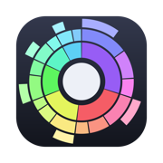
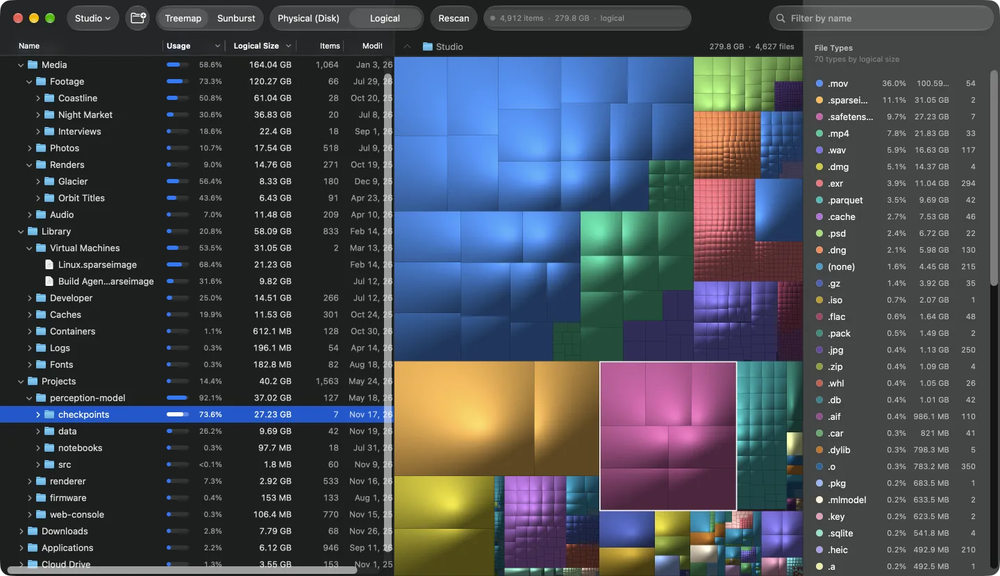
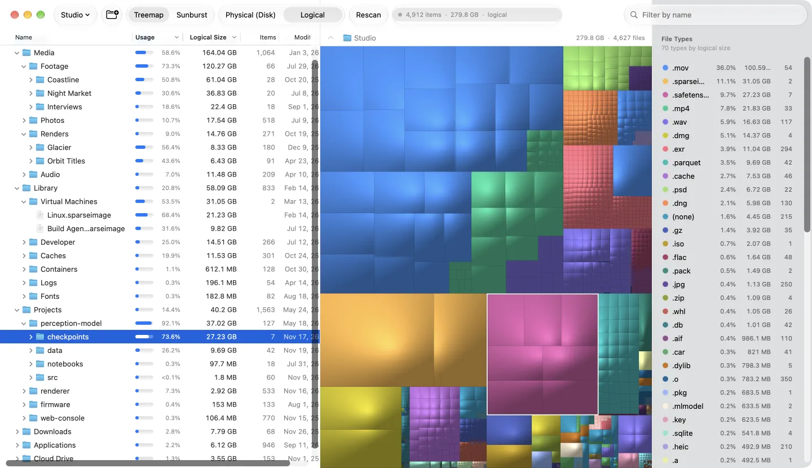
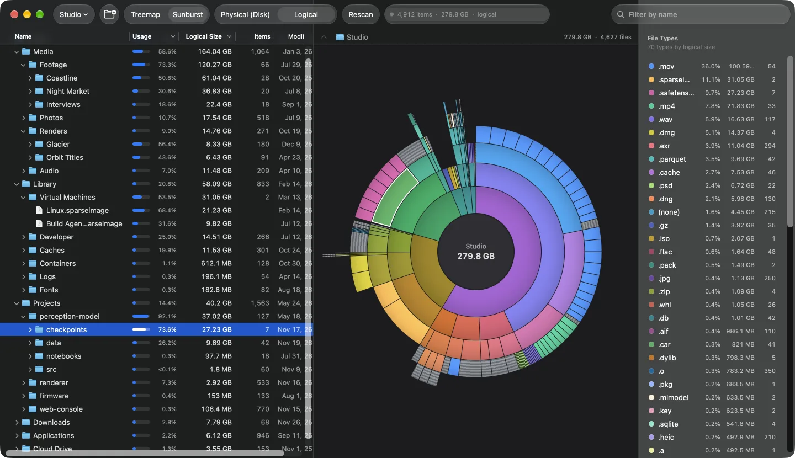
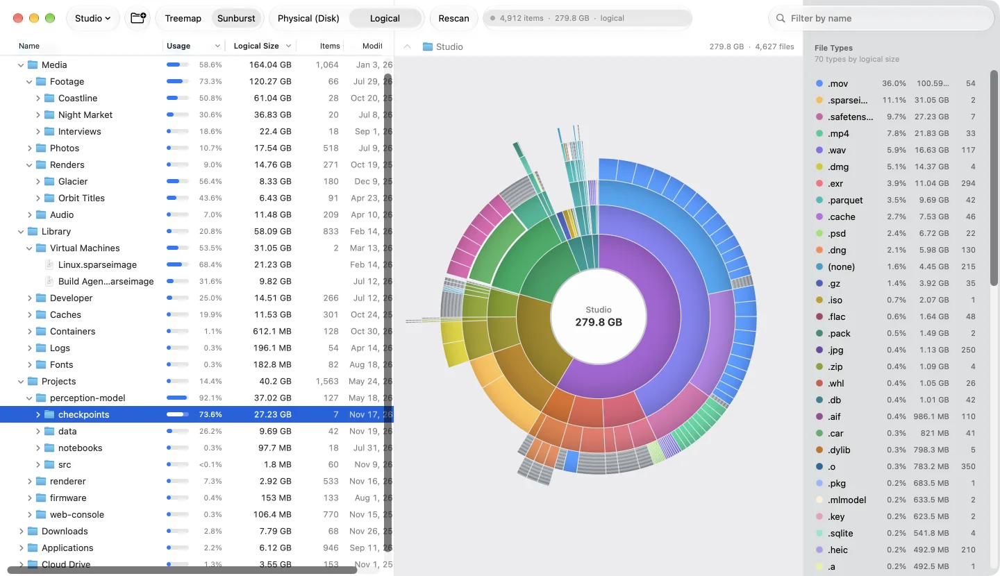

<p align="center"></p>
<h1 align="center">DiskPrism</h1>
<p align="center">A native macOS disk space analyzer that fits in 612 KiB.<br>C++20, AppKit and Metal. No dependencies.</p>
<p align="center"><b><a href="https://berkayceylan.github.io/DiskPrism/">Website and live demo</a></b> &nbsp;·&nbsp; <a href="#download">Download</a> &nbsp;·&nbsp; <a href="#build">Build</a> &nbsp;·&nbsp; <a href="#benchmarks">Benchmarks</a> &nbsp;·&nbsp; <a href="#how-it-works">How it works</a></p>
<p align="center"><a href="https://github.com/berkayceylan/DiskPrism/releases/latest"></a> <a href="https://github.com/berkayceylan/DiskPrism/actions/workflows/ci.yml"></a> <a href="https://github.com/berkayceylan/DiskPrism/actions/workflows/pages.yml"></a> <a href="LICENSE"></a></p>

| | Dark | Light |
| --- | --- | --- |
| **Treemap** |  |  |
| **Sunburst** |  |  |

<sub>The screenshots show a synthetic tree made by [`tools/make_demo_data.py`](tools/make_demo_data.py).</sub>

DiskPrism scans with `getattrlistbulk()`, keeps the whole tree in one flat array, and draws it as a squarified cushion
treemap or a sunburst with Metal. The interface is written entirely in code: no Xcode project, nibs, storyboards,
SwiftUI, package manager or third-party libraries.

## Features

- Cushion treemap and sunburst on the same data, with animated drill-down
- Physical size (what files occupy on this disk) or logical size (how long they are)
- Directory tree, map and file-type list that stay in sync
- Filter by name or file type; everything else is dimmed
- Reveal in Finder, Quick Look, Copy Path, Open in Terminal and Move to Trash. Deleting updates the map without a rescan
- Drag a folder or volume onto the window to scan it
- Dark and light mode, and no frames drawn while nothing changes

## Download

Get the [latest release](https://github.com/berkayceylan/DiskPrism/releases/latest): the `arm64` zip for Apple silicon (612 KiB unpacked)
or the `x86_64` zip for Intel (648 KiB). It needs macOS 14 or later.

The app is signed ad hoc and not notarized by Apple, so macOS blocks the first launch. In System Settings, open Privacy &
Security, scroll down, click **Open Anyway** and confirm. An app you build yourself opens normally.

Before a release is published, its apps are tested in virtual machines with macOS 15, 26 and 27 on Apple silicon and
macOS 15 on Intel. macOS 14 and the graphics drivers of physical Intel Macs are untested.

## Build

You need macOS 14 or later, CMake 3.24 or later, and the Xcode Command Line Tools (`xcode-select --install`). The full
Xcode IDE and the offline `metal` compiler are not needed: `Shaders.metal` ships as text in the bundle and is compiled
at launch.

```bash
git clone https://github.com/berkayceylan/DiskPrism.git
```

```bash
cd DiskPrism
```

```bash
cmake -S . -B build -DCMAKE_BUILD_TYPE=Release
```

```bash
cmake --build build -j
```

```bash
open build/DiskPrism.app
```

To scan a folder straight away, use `open -n build/DiskPrism.app --args /Applications`.

**If CMake warns that the C++ headers are missing:** some Command Line Tools updates leave a stale, nearly empty
`/Library/Developer/CommandLineTools/usr/include/c++` folder behind that hides the real headers. The build detects this
and uses the SDK's headers instead.

**Signing and Gatekeeper:** the build signs the app ad hoc, on your own Mac, so an app you built yourself opens
normally. If you copy it to another Mac, macOS blocks the first launch there, as with a [download](#download).

**Full Disk Access** is optional. Without it macOS hides some protected folders, and DiskPrism shows how many it
skipped. Because the signature is ad hoc, macOS ties the permission to one build and may ask again after you rebuild.

## Benchmarks

Apple M2, 8 GB, Release build, warm disk cache.

| Scan | Files | Folders | Time | Peak memory |
| --- | ---: | ---: | ---: | ---: |
| `/Applications`, 8 threads | 224,913 | 47,003 | **0.495 s** (454,024 files/s) | 35 MB |
| `/Applications`, 1 thread | 224,913 | 47,003 | 1.43 s | 25 MB |
| `/Applications` with `du -sk` | | | 4.97 s | |
| Whole startup disk | 2,046,512 | 520,131 | 9.4 s | 192 MB |

The DiskPrism time is the median of 15 runs, which took 0.48 to 0.66 s. The `du` time is its first run; nine more under
the same conditions took 3.86 to 7.02 s. DiskPrism is therefore 8× faster comparing the fastest runs, 14× comparing
medians, and about 10× against the first. `du` uses one thread.

| Rendering and interaction | |
| --- | ---: |
| 440,000 nodes to 47,841 blocks, one draw call, GPU time at 2880×1800 | 1.8 ms |
| Hit test, treemap / sunburst | 59 ns / 97 ns |
| Hover event to GPU state and read-out, median | 0.56 ms |
| Frames drawn and CPU while idle | 0 and 0.0% |
| App bundle / arm64 executable | 612 KiB / 436 KB |

Measure your own Mac:

```bash
build/DiskPrism.app/Contents/MacOS/DiskPrism --benchmark /Applications --runs 5
```

## How it works

**Scanning.** Worker threads steal directories from each other, read each one with `getattrlistbulk()` into a 128 KiB
buffer, and decode the records with bounds checks and `memcpy` (8-byte fields sit on 4-byte boundaries). The kernel packs
attributes by bit value, so `ALLOCSIZE` comes before `DATALENGTH`.

**One flat array.** Every file is a 56-byte record in one contiguous region of virtual memory, linked by 32-bit indices,
with names in a string pool. Threads reserve space with one atomic step. Parents always precede children, so adding up
sizes is a single backward pass, and deleting a file subtracts its size in O(depth).

**Firmlinks.** `/` and `/System/Volumes/Data` report the same device ID, so comparing `st_dev` would count user data
twice. DiskPrism checks the mount status of each entry (`ATTR_DIR_MOUNTSTATUS`), the mount table, and the device ID. In a
scan of a whole startup disk, none of 2,006,687 single-link files and 520,932 folders was counted twice.

**What counts as used space**

- Physical size is allocated blocks; logical size is file length
- Cloud-only files (`SF_DATALESS`) count 0 physical bytes. Scan threads run under an I/O policy that forbids
  downloading them, and dataless folders are never opened
- A hard-linked file is counted once; its other names are flagged and count 0
- Symbolic links are recorded and never followed
- APFS clones each report their full allocation, as in Finder and `du`. Snapshots are not files and are not included

**Rendering.** Each treemap block carries the summed parabola coefficients of its cushion. The fragment shader derives the
surface normal from them. Sunburst arcs are evaluated in polar coordinates with signed-distance edges. Either scene is one
instanced triangle-strip draw. Transitions interpolate on the GPU, and the display link is destroyed the moment they end.

## Tests

```bash
ctest --test-dir build --output-on-failure
```

More than 28,500 checks cover record decoding (including 20,000 corrupted buffers), hard links, sparse files, symlink
loops, firmlinks, mounts, permissions, cancellation, layout geometry, shader compilation, rendered pixels and the real
window controller. The sanitizer build runs the same suite:

```bash
cmake -S . -B build-asan -DCMAKE_BUILD_TYPE=Debug -DENABLE_SANITIZERS=ON
```

```bash
cmake --build build-asan -j
```

```bash
ctest --test-dir build-asan --output-on-failure
```

Apple's AddressSanitizer has no leak detector, so the normal build also runs the core tests under `leaks`. `test_ui` opens
fully transparent windows, and moves two of its own files to the Trash and deletes them again.

## Command line

```bash
build/DiskPrism.app/Contents/MacOS/DiskPrism --snapshot /Applications --out map.png --mode sunburst --size 2880x1800
```

`--snapshot` renders the map off screen with the app's own Metal pipeline. `--help` lists all options.

## Repository

```
src/core/   C++20 engine (no AppKit, no Metal)
src/gpu/    Shaders.metal, renderer, map view
src/ui/     AppKit interface and command-line modes
tests/      test suite
tools/      benchmark, icon generator, demo data generator
website/    the showcase site, served by GitHub Pages
```

## License

[MIT](LICENSE)
